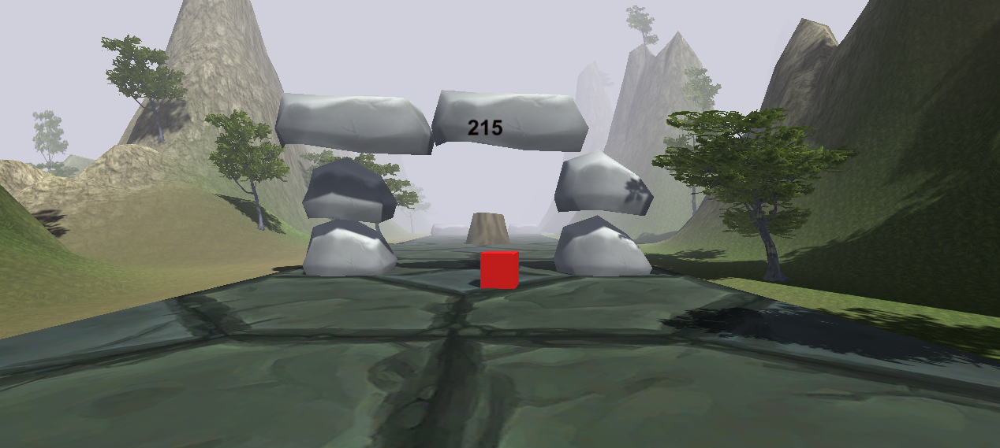

# CUBE.io

An arcade-style cube game set across changing environments. Guide the cube through obstacle-filled levels, select stages from the level menu, and explore different worlds.

## Gallery

| Game view | Beach world | Space world |
|:---:|:---:|:---:|
|  |  |  |

## Requirements

- Unity Editor `2020.1.0b16` (the project version)
- Android Build Support, Android SDK & NDK Tools, and OpenJDK for Android builds

The project uses a legacy beta Unity Editor. Unity Hub marks this release with a security alert; use it only with projects you trust. Consider migrating to a supported Editor version separately, after making a backup.

## Open and play

1. In Unity Hub, choose **Add** or **Import project**.
2. Select the inner `Cube.io` folder that contains `Assets`, `Packages`, and `ProjectSettings`.
3. Open the project with Unity `2020.1.0b16` and let the initial asset import finish.
4. In the Project panel, open `Assets/levelsr/start.unity`.
5. Press **Play** in the Editor, then choose **PLAY** on the game menu.

## Android build

1. Install the Android modules listed under Requirements through Unity Hub.
2. In Unity, open **File > Build Settings**, select **Android**, then choose **Switch Platform**.
3. Connect an Android device with USB debugging enabled and select **Build and Run**.

The project has Android build support and landscape orientation configured. A build or play test on a physical Android device has not been verified.
